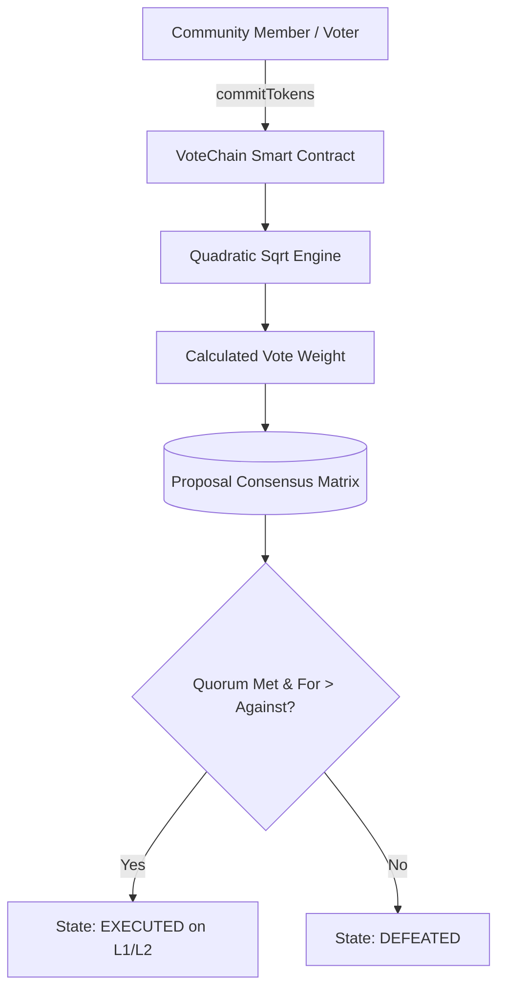

# VoteChain — Transparent On-Chain Governance & Quadratic Voting Protocol


VoteChain is an on-chain DAO governance protocol engineered with **Quadratic Voting** $\text{Weight} = \sqrt{\text{Tokens Committed}}$ to eliminate plutocratic capture in decentralized ecosystems. In traditional 1-token-1-vote models, crypto whales possess disproportionate power to force malicious proposals through. VoteChain neutralizes whale dominance by mathematically dampening voting power, empowering broad community consensus while maintaining economic commitment incentives.

---

## Quadratic Voting Mathematics

$$\text{Vote Power} = \sqrt{T}$$

| Committed Tokens ($T$) | 1-Token-1-Vote Power | Quadratic Weight ($\sqrt{T}$) | Relative Whale Dampening |
|---|---|---|---|
| **100 $VOTE** | 100 votes | **10.00 votes** | Baseline |
| **10,000 $VOTE** ($100\times$) | 10,000 votes ($100\times$) | **100.00 votes** ($10\times$) | **10x Power Compression** |
| **1,000,000 $VOTE** ($10,000\times$) | 1,000,000 votes ($10,000\times$) | **1,000.00 votes** ($100\times$) | **100x Power Compression** |

---

## Architecture Flow



---

## Key Features

1. **Quadratic Power Compression:** Integer square-root calculation on committed governance tokens preventing whale hijacking.
2. **Quorum & Supermajority Safeguards:** Strict minimum token commitment requirements before any proposal can pass into execution.
3. **Cryptographically Verifiable Ballots:** Immutable SQLite WAL and on-chain event receipt indexing for real-time auditability.
4. **Interactive Quadratic Simulator:** Live calculator widget enabling community members to preview token commitment power before casting votes.
5. **Modern Civic UI:** Sapphire and slate governance interface with real-time voting progress bars and proposal state machines.

---

## Technology Stack

- **Smart Contracts:** Solidity `^0.8.20`, Babylonian integer square root algorithm, EVM Sepolia testnet
- **Backend Service:** Node.js 22, Express.js, native `node:sqlite` (WAL mode)
- **Frontend:** Vanilla JavaScript (ES6+), Modern Responsive CSS
- **Testing:** Node.js native test runner (`node:test`, `node:assert/strict`)
- **DevOps:** Docker, Docker Compose, GitHub Actions CI

---

## Local Development & Testing

```bash
# Clone the repository
git clone https://github.com/Soulofghost/votechain.git
cd votechain/backend

# Install dependencies
npm install

# Run automated tests
npm test

# Launch local governance node
npm start
```
Open `http://localhost:4026` to explore proposals and cast quadratic ballots.

---

## License

SPDX-License-Identifier: MIT  
Copyright (c) 2026 Alvin MS ([@Soulofghost](https://github.com/Soulofghost)).
